<picture>
  <source media="(prefers-color-scheme: dark)" srcset="assets/banner-dark.svg">
  <source media="(prefers-color-scheme: light)" srcset="assets/banner-light.svg">
  
</picture>

  <a href="mailto:molina.fernandez.cristopherian@gmail.com"><picture><source media="(prefers-color-scheme: dark)" srcset="assets/icons/mail-dark.svg"></picture></a>&nbsp;&nbsp;&nbsp;
  <a href="https://www.linkedin.com/in/cristopher-molina-f"><picture><source media="(prefers-color-scheme: dark)" srcset="assets/icons/linkedin-dark.svg"></picture></a>&nbsp;&nbsp;&nbsp;
  <a href="https://cris-mmolina-page.vercel.app"><picture><source media="(prefers-color-scheme: dark)" srcset="assets/icons/web-dark.svg"></picture></a>

Estudiante de **Ingeniería en Informática** en el IPN (UPIICSA). Construyo software de punta a punta con **IA, visualización geoespacial y datos abiertos**: mapas que ayudan a una ciudad a decidir. Trabajo sobre todo con JavaScript, Python y React.

## Reconocimientos

<picture>
  <source media="(prefers-color-scheme: dark)" srcset="assets/awards-dark.svg">
  
</picture>

## Proyectos

  <a href="https://mercur-ia.vercel.app/map"><picture>
    <source media="(prefers-color-scheme: dark)" srcset="assets/project-mercuria-dark.svg">
    
  </picture></a>
  <a href="https://lumiv-ia-f.vercel.app/"><picture>
    <source media="(prefers-color-scheme: dark)" srcset="assets/project-lumivia-dark.svg">
    
  </picture></a>
  <picture>
    <source media="(prefers-color-scheme: dark)" srcset="assets/project-railsense-dark.svg">
    
  </picture>
  <picture>
    <source media="(prefers-color-scheme: dark)" srcset="assets/project-psyness-dark.svg">
    
  </picture>

Código: <a href="https://github.com/zoe718/MercurIA">MercurIA</a> · <a href="https://github.com/crisMmolina/LumivIA-F">LumivIA</a>

## Stack

<picture>
  <source media="(prefers-color-scheme: dark)" srcset="https://skillicons.dev/icons?i=js,ts,react,vite,nodejs,py,java,c,html,css,bootstrap,mysql,git,github,vercel,cloudflare&theme=dark&perline=16">
  
</picture>

También: Oracle Database, Neon, Render, Google Cloud, SCRUM · Inglés B1

## Actividad

<picture>
  <source media="(prefers-color-scheme: dark)" srcset="assets/generated/pacman-dark.svg">
  
</picture>

  
<b>Ver estadísticas</b>

   
  <picture>
    <source media="(prefers-color-scheme: dark)" srcset="assets/generated/stats-dark.svg">
    
  </picture>

